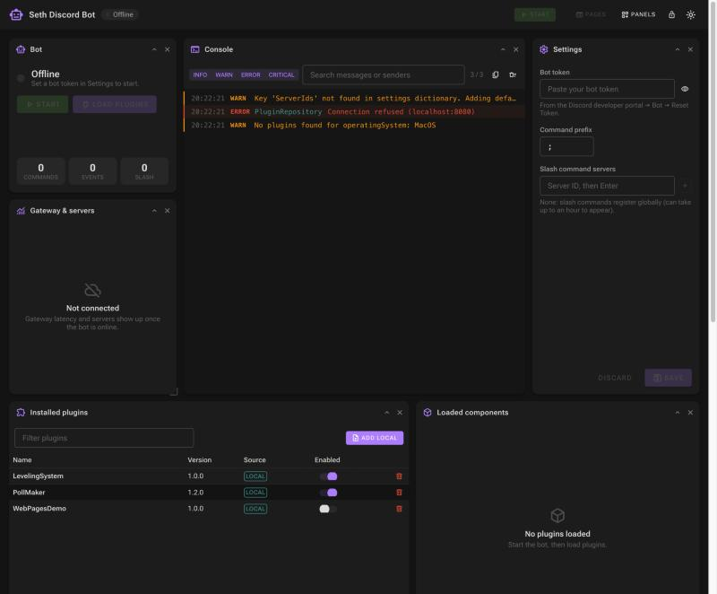

# Seth Discord Bot documentation

Seth is a Discord bot written in C# (.NET 10, [Discord.Net](https://github.com/discord-net/Discord.Net)) whose features come from **plugins**. The bot itself only connects to Discord, dispatches commands and hosts plugins. Everything else, such as leveling, polls or your own commands, lives in plugin DLLs that you can add, enable, disable and reload at runtime from a web dashboard.

## Where to start

| I want to… | Read |
| --- | --- |
| Get the bot running for the first time | [Getting started](getting-started/requirements.md) |
| Configure the token, prefix, servers or folders | [Configuration](configuration/bot-configuration.md) |
| Learn what each dashboard panel does | [Dashboard](dashboard/overview.md) |
| Install, enable or remove plugins | [Using plugins](using-plugins/managing-plugins.md) |
| Write my own plugin | [Creating plugins](creating-plugins/README.md) |
| Understand how the code is organized | [Architecture](architecture/overview.md) |
| Fix a problem | [Troubleshooting](troubleshooting.md) |

## Contents

### Getting started
1. [Requirements](getting-started/requirements.md)
2. [Create the Discord application](getting-started/create-discord-application.md)
3. [Run from source](getting-started/run-from-source.md) or [Run with Docker](getting-started/run-with-docker.md)
4. [First start](getting-started/first-start.md)

### Configuration
- [Bot configuration (`config.json`)](configuration/bot-configuration.md)
- [Host settings (logging, URLs, environment variables)](configuration/host-settings.md)
- [The `Data` folder](configuration/data-folder.md)

### Dashboard
- [Overview and layout](dashboard/overview.md)
- [Panels reference](dashboard/panels.md)

### Using plugins
- [Managing plugins](using-plugins/managing-plugins.md)
- [Built-in commands](using-plugins/built-in-commands.md)
- [Sample plugins](using-plugins/sample-plugins.md)
- [Marketplace and plugin repository](using-plugins/marketplace.md)

### Creating plugins
- [Overview and quick start](creating-plugins/README.md)
- [Project setup](creating-plugins/project-setup.md)
- [Commands](creating-plugins/commands.md)
- [Events](creating-plugins/events.md)
- [Slash commands and interactions](creating-plugins/slash-commands.md)
- [Storage, configuration and logging](creating-plugins/storage-and-logging.md)
- [Web pages](creating-plugins/web-pages.md)
- [Third-party dependencies](creating-plugins/dependencies.md)
- [Native (C/C++) libraries](creating-plugins/native-libraries.md)
- [Build, test and debug](creating-plugins/build-test-debug.md)

### Architecture
- [Project overview](architecture/overview.md)
- [Plugin lifecycle](architecture/plugin-lifecycle.md)
- [Developing the bot itself](architecture/developing.md)

### Help
- [Troubleshooting](troubleshooting.md)
