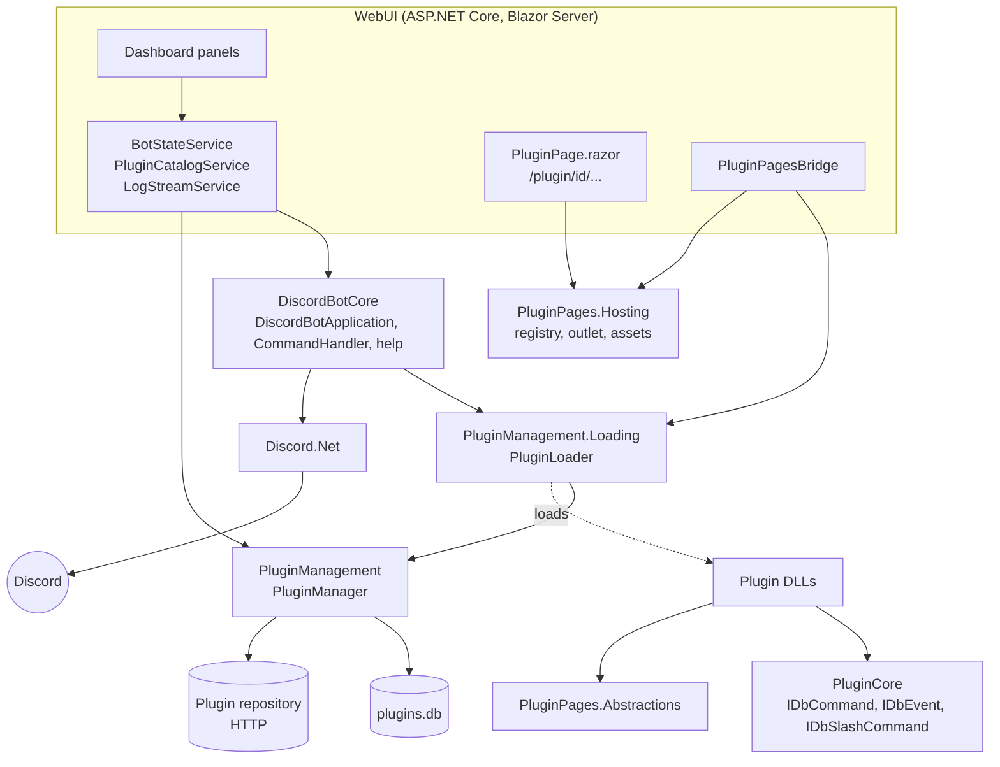

# Project overview

The bot is a set of libraries (`DiscordBotCore.*`) hosted by a Blazor Server app (`WebUI`). There's no console entry point: the WebUI wires every core service into dependency injection, and the dashboard starts the bot and loads plugins.

## Projects

### Foundation

| Project | Contents |
| --- | --- |
| `DiscordBotCore.Logging` | `ILogger`/`Logger`: in-memory history, daily log files, `OnLogReceived` event. |
| `DiscordBotCore.Configuration` | `IConfiguration`/`Configuration`: a JSON-backed dictionary (`config.json`, Newtonsoft.Json). |
| `DiscordBotCore.Utilities` | `IResponse<T>`/`Response`, `Result`, `JsonManager`, `ArchiveManager`, `OperatingSystem`. |
| `DiscordBotCore.Networking` | `FileDownloader`, `ParallelDownloadExecutor`. |
| `DiscordBotCore.Database.Sqlite` | `SqlDatabase`, a small SQLite wrapper. |
| `DiscordBotCore.Resources` | Default configuration keys and paths (everything under `./Data`). |

### Bot and plugins

| Project | Contents |
| --- | --- |
| `DiscordBotCore.PluginCore` | **The plugin contract**: `IDbCommand`, `IDbEvent`, `IDbSlashCommand` and their argument types. Plugins reference this. |
| `DiscordBotCore.PluginManagement` | `PluginManager`: the installed-plugin database (`plugins.db`) and the remote repository client. |
| `DiscordBotCore.PluginManagement.Loading` | `PluginLoader`: loads enabled plugin DLLs into a collectible `AssemblyLoadContext`, creates their components and registers them. |
| `DiscordBotCore` | `DiscordBotApplication` (Discord client lifecycle), `CommandHandler` (prefix/mention parsing and dispatch), the built-in `HelpCommand`. |

### Modules

| Project | Contents |
| --- | --- |
| `Modules/PluginPages.Abstractions` | What plugins use for web pages: `[PluginPage]`, `PluginPageContext`, `PluginStylesheet`. |
| `Modules/PluginPages.Hosting` | Host side of plugin pages: route validation and matching, the registry, `PluginPageOutlet`, embedded asset endpoints. No Discord dependency. |
| `Modules/CppCompatibilityModule` | Helpers for loading native libraries and binding function pointers to delegates. |

### Host

| Project | Contents |
| --- | --- |
| `WebUI` | The ASP.NET Core app. `Initializer.cs` registers the core services; `Services/` holds the dashboard's state services; `Components/` the Blazor UI (Radzen components, Gridstack.js for the layout). |

### Plugins and tests

| Folder | Contents |
| --- | --- |
| `Plugins/` | [Sample plugins](../using-plugins/sample-plugins.md): LevelingSystem, PollMaker, WebPagesDemo, CppModuleDemo. |
| `Tests/` | xUnit + Moq tests for the configuration, the logger and plugin pages. |

## Conventions

- Fallible operations return `IResponse<T>` (`Response<T>.Success(...)`, `Response.Failure(...)`) instead of throwing.
- Logging goes through `DiscordBotCore.Logging.ILogger` (`Log(message, sender, LogType)`, `LogException`). In the WebUI it's aliased (`using ILogger = DiscordBotCore.Logging.ILogger;`) because it clashes with `Microsoft.Extensions.Logging.ILogger`.
- Private fields use an `_PascalCase` prefix (`_Logger`, `_PluginManager`).

## Services in the WebUI

| Service | Lifetime | Role |
| --- | --- | --- |
| `ILogger`, `IConfiguration`, `IPluginRepository`, `ILocalPluginRepository`, `IPluginManager`, `IPluginLoader`, `IDiscordBotApplication` | Singleton | The core, created in `Initializer.AddDiscordBotComponents`. |
| `BotStateService` | Singleton | The only owner of the bot lifecycle: start (with a 30-second watchdog), stop, load/reload plugins, gateway stats. Serializes operations so concurrent clicks can't overlap. |
| `PluginCatalogService` | Singleton | Installed and online plugin lists, install/uninstall/enable/add-local, install progress. |
| `LogStreamService` | Singleton | Throttled log updates for the Console panel. |
| `DashboardLayoutService` | Scoped (per browser) | Panel positions, visibility, collapse and lock, saved in local storage. |
| `IPluginPageRegistry` | Singleton | Registered plugin pages. |
| `PluginPagesBridge` | Hosted service | Registers pages after plugins load and clears them before they unload. |

Components never call the core directly for actions. They go through the singleton services, which raise `Changed` so every open tab updates, and return `IResponse<T>` for the UI to report.

---

Next: [Plugin lifecycle](plugin-lifecycle.md)
