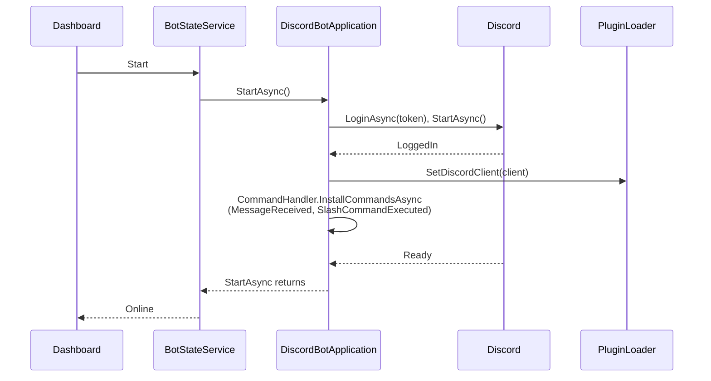
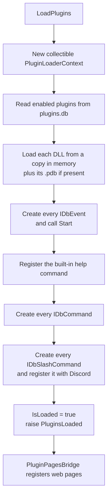
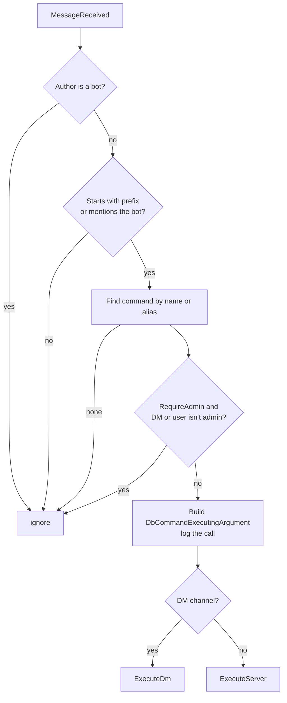

# Plugin lifecycle

This page follows a plugin from installation to unload, with the classes involved.

## 1. Installation

Plugins are discovered from the **plugin database**, not by scanning `Data/Plugins`. A row is created by:

- **Add local** → `PluginCatalogService.AddLocalAsync` saves the upload into the plugin folder, then `PluginManager.CreateOfflineLocalPlugin` + `AppendPluginToDatabase` add the row (`is_offline_added = 1`).
- **Marketplace install** → `PluginManager.InstallPlugin` downloads the DLL and its dependencies and adds the row.

## 2. Starting the bot

`StartAsync` only returns once the gateway is *Ready*. `BotStateService` waits for it for 30 seconds, then reports a timeout while the connection keeps trying in the background.

## 3. Loading plugins

**Load plugins** calls `PluginLoader.LoadPlugins()`, which must run after the client was set (events and slash commands need it):

Details:

- DLLs are loaded **from memory**, not by path. The file stays unlocked, and replacing it then reloading always picks up the new version.
- All plugins share **one** load context. Types are found with `Assembly.GetTypes()`; if some types can't load (missing dependency), the others are still used.
- **Events** get the client, the prefix, the logger and `Data/Resources/<assembly name>` (created). A failing `Start` skips that event.
- **Commands** are only added to the list; the `CommandHandler` looks them up on each message.
- **Slash commands** are registered on each server in `ServerIds`, or globally if it's empty. Skipped if the client isn't set or the bot is in no server. With `HasInteraction`, an `InteractionCreated` handler is attached.
- After `PluginsLoaded`, `PluginPagesBridge` registers each plugin's pages under its database id.

## 4. Handling a message

Slash commands are dispatched by name from `SlashCommandExecuted` to `ExecuteServer` or `ExecuteDm`.

## 5. Unloading

`UnloadAllPlugins()` runs on **Reload plugins**, **Stop**, and around **delete**:

1. Raise `PluginsUnloading`; `PluginPagesBridge` clears the page registry and Blazor's per-type caches.
2. Detach interaction handlers and delete every registered slash command from Discord.
3. Clear the command, event and slash command lists.
4. Unload the load context and run the garbage collector so the assemblies can be collected.

What is **not** undone: handlers that events attached to the client, timers and tasks they started, native libraries they loaded, and assemblies loaded from `Libraries/`. **Stop** disposes the client, which removes the client handlers.

## 6. Stopping the bot

**Stop** → `DiscordBotApplication.StopAsync()`: unload plugins if loaded, log out, stop and dispose the client, clear the loader's client reference. The next **Start** creates a new client; plugins must be loaded again.
