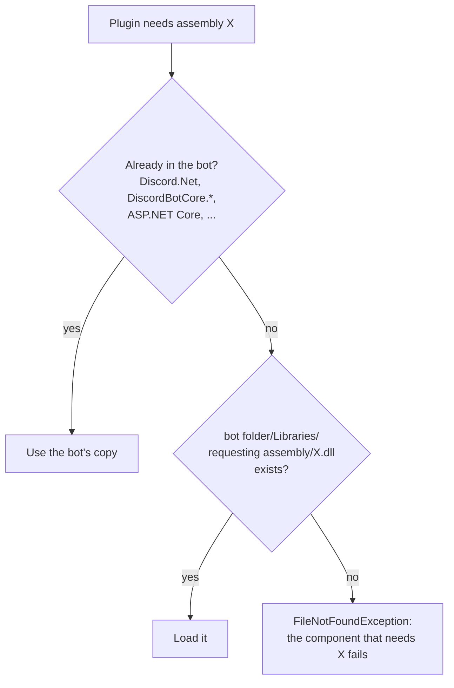

# Third-party dependencies

Only a plugin's **main DLL** is loaded from `Data/Plugins`. When the plugin uses another assembly, the runtime looks for it in this order:



1. **The bot's own assemblies.** Everything listed in [Project setup](project-setup.md#what-you-can-reference) is shared with plugins. Nothing to ship.
2. **The `Libraries` folder.** Anything else is looked up in `Libraries/<name of the assembly that needs it>/<assembly name>.dll` next to the WebUI binaries (the folder that contains `WebUI.dll`).

## Shipping a dependency

Say `WeatherPlugin.dll` uses the `Humanizer` package.

1. Build the plugin. `Humanizer.dll` is in the build output next to `WeatherPlugin.dll`.
2. Copy it to `Libraries/WeatherPlugin/` in the WebUI's binary folder:

   | How you run the bot | Folder |
   | --- | --- |
   | `dotnet run --project WebUI` (Debug) | `WebUI/bin/Debug/net10.0/Libraries/WeatherPlugin/` |
   | Published build | `<publish folder>/Libraries/WeatherPlugin/` |
   | Docker | `/app/Libraries/WeatherPlugin/` (mount a volume) |

3. Add `WeatherPlugin.dll` with **Add local** and load plugins.

The folder name is the **assembly name** of the assembly that references the dependency. For a dependency of a dependency (Humanizer needing `X.dll`), the requesting assembly is `Humanizer`, so `X.dll` goes to `Libraries/Humanizer/`.

To collect everything a plugin needs, publish it and compare with the bot's assemblies:

```bash
dotnet publish Plugins/WeatherPlugin -c Release -o ./out/WeatherPlugin
```

## Marketplace plugins

Plugins installed from the [Marketplace](../using-plugins/marketplace.md) get their dependencies downloaded automatically into `./Libraries/<plugin name>/`. That path is relative to the **working directory**, while the resolver looks next to the binaries; they are the same folder in Docker and when you run a published build from its own folder, but not with `dotnet run` (working directory `WebUI/`, binaries in `WebUI/bin/...`). Run the bot from its binary folder when you rely on marketplace dependencies.

## Things to know

- Dependencies are loaded into the process permanently (`Assembly.LoadFrom`), unlike the plugin itself. Replacing a dependency needs a restart of the WebUI.
- Two plugins may need different versions of the same library. The first one loaded wins for the whole process. Prefer libraries the bot already ships, and keep versions aligned.
- **Never ship** copies of the bot's assemblies (`DiscordBotCore.*`, `Discord.Net*`, `PluginPages.Abstractions`): the bot's copy is always used, and a second copy can cause type mismatches. Reference them with `Private="false"`.
- Native libraries (`.so`, `.dylib`, native `.dll`) aren't resolved this way; load them by full path. See [Native libraries](native-libraries.md).
