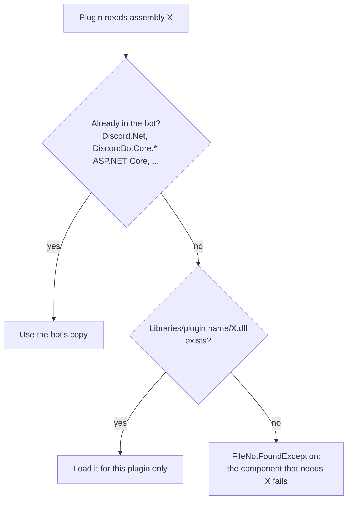

# Third-party dependencies

Only a plugin's **main DLL** is loaded from `Data/Plugins`. Each plugin has its own load context. When a plugin uses another assembly, it is looked up in this order:



1. **The bot's own assemblies.** Everything listed in [Project setup](project-setup.md#what-you-can-reference) is shared with plugins. Nothing to ship.
2. **The plugin's libraries folder.** Anything else comes from `Libraries/<plugin name>/`, under the working directory or next to the WebUI binaries (the folder that contains `WebUI.dll`).

## NuGet packages

Plugins published on the [Marketplace](../using-plugins/marketplace.md) list the NuGet packages they need. When the plugin is installed, the bot downloads those packages and everything they depend on directly from nuget.org into `Libraries/<plugin name>/`. Assemblies the bot already ships are skipped, and the install fails with a message if a package needs a newer version of one of them.

## Shipping a dependency yourself

Say a plugin named `WeatherPlugin` uses the `Humanizer` package, and you add it with **Add local**.

1. Build the plugin. `Humanizer.dll` is in the build output next to `WeatherPlugin.dll`.
2. Copy it, and anything it needs in turn, to `Libraries/WeatherPlugin/` in the WebUI's binary folder:

   | How you run the bot | Folder |
   | --- | --- |
   | `dotnet run --project WebUI` (Debug) | `WebUI/bin/Debug/net10.0/Libraries/WeatherPlugin/` |
   | Published build | `<publish folder>/Libraries/WeatherPlugin/` |
   | Docker | `/app/Libraries/WeatherPlugin/` (mount a volume) |

3. Add `WeatherPlugin.dll` with **Add local** and load plugins.

The folder name is the **plugin's name**, and every dependency goes in that one folder, including a dependency of a dependency.

To collect everything a plugin needs, publish it and compare with the bot's assemblies:

```bash
dotnet publish Plugins/WeatherPlugin -c Release -o ./out/WeatherPlugin
```

## Things to know

- Two plugins can use different versions of the same library, because each loads its own copy.
- A plugin can't reference another plugin's assembly directly.
- Unloading plugins also unloads their dependencies, so a reload picks up new versions without a restart. This only works if the plugin stopped everything it started: a task, timer or event handler left running keeps the plugin in memory. The bot then shows a "restart recommended" warning and keeps running.
- **Never ship** copies of the bot's assemblies (`DiscordBotCore.*`, `Discord.Net*`, `PluginPages.Abstractions`): the bot's copy is always used. Reference them with `Private="false"`.
- Native libraries (`.so`, `.dylib`, native `.dll`) in the plugin's folder, or its `runtimes/<rid>/native` subfolder, are found by `DllImport`. They load from a private copy and are freed once the plugin has unloaded. If a native library keeps its own background threads running, freeing it can crash the process; set `FreeNativeLibraries` to `false` in `config.json` to keep old copies in memory until the next restart instead. See [Native libraries](native-libraries.md).
