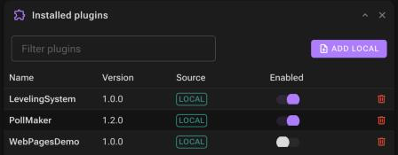

# Panels reference

The dashboard has eight panels. All of them can be moved, resized, collapsed and hidden ([Overview](overview.md#arranging-panels)).

## Bot

The bot's status and its two main actions.

- Status (*Offline*, *Connecting to Discord…*, *Online*, *Reconnecting…*, *Stopping…*), uptime and the bot's user name.
- **Start / Stop / Cancel**, like the header buttons.
- **Load plugins / Reload plugins**: loads every enabled plugin, or unloads and loads them again. Only available while the bot is online.
- Counters for loaded commands, events and slash commands.

If the bot hasn't reached *Ready* after 30 seconds, **Start** returns an error, but the connection keeps trying in the background; **Cancel** stops it.

 

## Gateway & servers

Shown once the bot is online:

- **Latency**: the current gateway latency, colored by quality, with a sparkline of the last 40 measurements.
- **Servers**: how many servers the bot is in and their total member count, followed by the list of servers (largest first).

## Console

The live log of the bot, the plugins and the dashboard (the last `Logger:MaxHistorySize` messages, 1000 by default).

- **INFO / WARN / ERROR / CRITICAL**: toggle which levels are shown.
- **Search**: filters by message text or sender.
- `3 / 3`: shown lines / total lines.
- **Copy** copies the shown lines; **Clear** empties the console (log files on disk are kept).
- Click a line to open its details (full message, sender, time, level).
- Scrolling up pauses auto-scroll; **Jump to latest** resumes it.

The same messages go to the process console and to the daily file in `Data/Logs`.

## Settings

Edits the bot configuration (`config.json`):

- **Bot token**: masked; leave empty to keep the saved token.
- **Command prefix**: required, up to 5 characters.
- **Slash command servers**: server IDs to register slash commands on; none means global.

**Save** is enabled once something changed and the form is valid; **Discard** reverts the form. See [Bot configuration](../configuration/bot-configuration.md) for when each setting takes effect.

 

## Installed plugins

Every plugin in the plugin database.

| Column | Meaning |
| --- | --- |
| Name, Version | As recorded when the plugin was added or installed. |
| Source | **Local** (added from a DLL) or **Marketplace**. |
| Enabled | Whether the next load includes this plugin. While plugins are loaded, changing it shows **Reload to apply**. |
| ⓘ | Marketplace plugins only: the repository's details (description, author, latest version). |
| 🗑 | Deletes the plugin: its database row, its DLL and its `Libraries/<name>` files. Loaded plugins are unloaded first and reloaded afterwards. |

**Add local** uploads a plugin DLL. See [Managing plugins](../using-plugins/managing-plugins.md).

## Loaded components

What the last **Load plugins** actually loaded, in three tabs:

- **Commands**: the command with the current prefix, aliases, usage and description. The built-in `help` command is always here.
- **Events**: name and description.
- **Slash**: `/name`, description and whether it works in DMs.

Empty until plugins are loaded.

## Marketplace

The plugins published in the configured [plugin repository](../using-plugins/marketplace.md) for your operating system.

- Search by name, description or author; sort by any column; 25 plugins per page.
- **Install** downloads the plugin (and its dependencies) with a progress bar. Installed plugins show **Installed**.
- **Refresh** reloads the list.

If the repository can't be reached, the panel says so and the console has the error.

## Plugin pages

The web pages that loaded plugins provide, grouped by plugin, with their routes. Pages without route parameters are links. Pages that were **rejected** (invalid or overlapping routes, wrong component type, …) are listed with the reason. See [Plugin web pages](../creating-plugins/web-pages.md).
