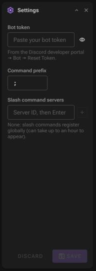
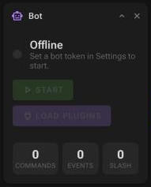

# First start

When the WebUI opens for the first time, the bot is **Offline** and has no token. Three steps get it online with plugins. (If you set a [dashboard password](../configuration/host-settings.md#dashboard-password), sign in first.)


## 1. Enter the token and prefix

In the **Settings** panel:



1. **Bot token**: paste the token from the Developer Portal ([how to get it](create-discord-application.md#2-get-the-bot-token)). The field is masked; the eye button shows it. After saving, the field stays empty and says *A token is saved*. Leave it empty to keep the saved token.
2. **Command prefix**: the text that starts a command, `;` by default (so `;help`). Up to 5 characters.
3. **Slash command servers**: paste a server ID and press Enter (or `+`). Slash commands are then registered on those servers only and show up immediately. With no IDs, they are registered globally, which can take up to an hour to appear in Discord.
4. **Start automatically** (optional): start the bot and load plugins every time the app starts, for example after a reboot or a container restart.
4. Click **Save**.

Settings are written to `Data/Resources/config.json`. If the bot is already running, the panel reminds you to restart it: the token is only read when the bot starts, the server list when plugins load, and events receive the prefix when they start. (Prefix commands pick up a new prefix on the next message.)

<br clear="right">

## 2. Start the bot



Click **Start**, in the **Bot** panel or in the header. The status goes from *Connecting to Discord…* to **Online**, and the header shows the uptime and bot name.

If it stays on *Connecting* for 30 seconds, the dashboard stops waiting and shows an error. The connection keeps retrying in the background until you click **Cancel**. The usual causes are a wrong token or missing privileged intents; see [Troubleshooting](../troubleshooting.md#the-bot-stays-on-connecting).

<br clear="right">

## 3. Load plugins

Once the bot is online, click **Load plugins** in the **Bot** panel. Every plugin that is installed **and enabled** is loaded; the counters show how many commands, events and slash commands are active, and the **Loaded components** panel lists them.

Plugins are not loaded automatically when the bot starts. After every start, click **Load plugins** again.

On a fresh install there are no plugins yet. Add one:

- build one of the [sample plugins](../using-plugins/sample-plugins.md) and add it with **Add local**, or
- install one from the [Marketplace](../using-plugins/marketplace.md) if you run a plugin repository, or
- [write your own](../creating-plugins/README.md).

## 4. Try it in Discord

In a channel the bot can read, type:

```text
;help
```

The bot answers with the list of commands. `;help <command>` shows the description, usage and aliases of one command. You can also mention the bot instead of using the prefix: `@YourBot help`.

## Stopping

**Stop** unloads the plugins (and deletes the slash commands they registered), logs out and disconnects. The dashboard keeps running; click **Start** again whenever you want.

---

Next: [Dashboard overview](../dashboard/overview.md) · [Managing plugins](../using-plugins/managing-plugins.md)
