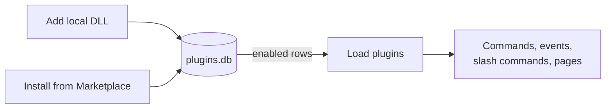
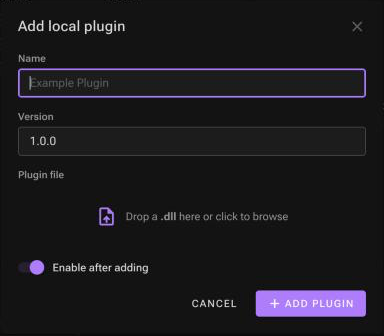

# Managing plugins

A plugin is a `.dll` file with commands, events, slash commands and optionally web pages. The bot keeps a list of installed plugins in its plugin database and loads the **enabled** ones when you click **Load plugins**.

## Add a plugin you built

1. In **Installed plugins**, click **Add local**.

   

2. Drop the plugin's `.dll` on the file area (or click to browse). Only `.dll` files up to 10 MB are accepted.
3. **Name**: filled from the file name. It must be unique among installed plugins. Keep it equal to the assembly name; other parts of the bot (dependency folders) are keyed by name.
4. **Version**: `major.minor.patch`, for example `1.0.0`.
5. **Enable after adding**: on by default.
6. Click **Add plugin**.

The file is copied to `Data/Plugins/<file name>` and a row is added to the plugin database. If the bot is online and plugins are loaded, click **Reload plugins** in the **Bot** panel to load it.

Only the main DLL is uploaded. If your plugin needs other assemblies that the bot doesn't already ship, see [Dependencies](../creating-plugins/dependencies.md).

## Install from the Marketplace

In the **Marketplace** panel, click **Install** next to a plugin. The DLL is downloaded into `Data/Plugins/<name>.dll`, its dependencies into `Libraries/<name>/`, and the plugin is added enabled. Then **Load plugins** or **Reload plugins**.

The Marketplace needs a plugin repository server. See [Marketplace and plugin repository](marketplace.md).

## Load and reload

| Action | Where | Effect |
| --- | --- | --- |
| **Load plugins** | Bot panel, or *Load now* in Loaded components | Loads every enabled plugin. Requires the bot to be online. |
| **Reload plugins** | Bot panel | Unloads all plugins, then loads the enabled ones again. Picks up new, updated, enabled and disabled plugins. |
| **Stop** | Bot panel or header | Unloads the plugins, then disconnects. |

Plugins are **not** loaded automatically when the bot starts: click **Load plugins** after each **Start**.

Unloading removes the plugin's commands and slash commands (the slash commands are also deleted from Discord) and releases the plugin's assembly. Events are a special case: any handler an event attached to the Discord client stays attached until the bot stops. After updating a plugin that has events, use **Stop**, **Start**, **Load plugins** rather than **Reload plugins**, or its old handlers keep running next to the new ones.

## Enable and disable

The **Enabled** switch decides whether a plugin is part of the next load. Disabling a plugin doesn't delete anything. If plugins are loaded when you change it, a **Reload to apply** button appears in the panel's toolbar.

## Update a plugin

- **Local plugin**: replace its file in `Data/Plugins` with the new build (the file isn't locked while loaded) and reload. Or delete the plugin and add the new DLL with a new version number.
- **Marketplace plugin**: delete it and install it again.

## Delete a plugin

Click the 🗑 button and confirm. The bot unloads the plugins if they are loaded, deletes the DLL, deletes the files in `Libraries/<name>/`, removes the plugin from the database, and loads the plugins again.

The plugin's data folder in `Data/Resources/` is **kept**, so reinstalling it later keeps its data. Delete that folder by hand if you want a clean start.

## Check what is loaded

- **Loaded components** lists the active commands, events and slash commands.
- The **Console** logs each step: `Command loaded: level`, `Event loaded: …`, `Slash command loaded: …`, and why something failed to load.
- In Discord, `;help` lists the commands.
